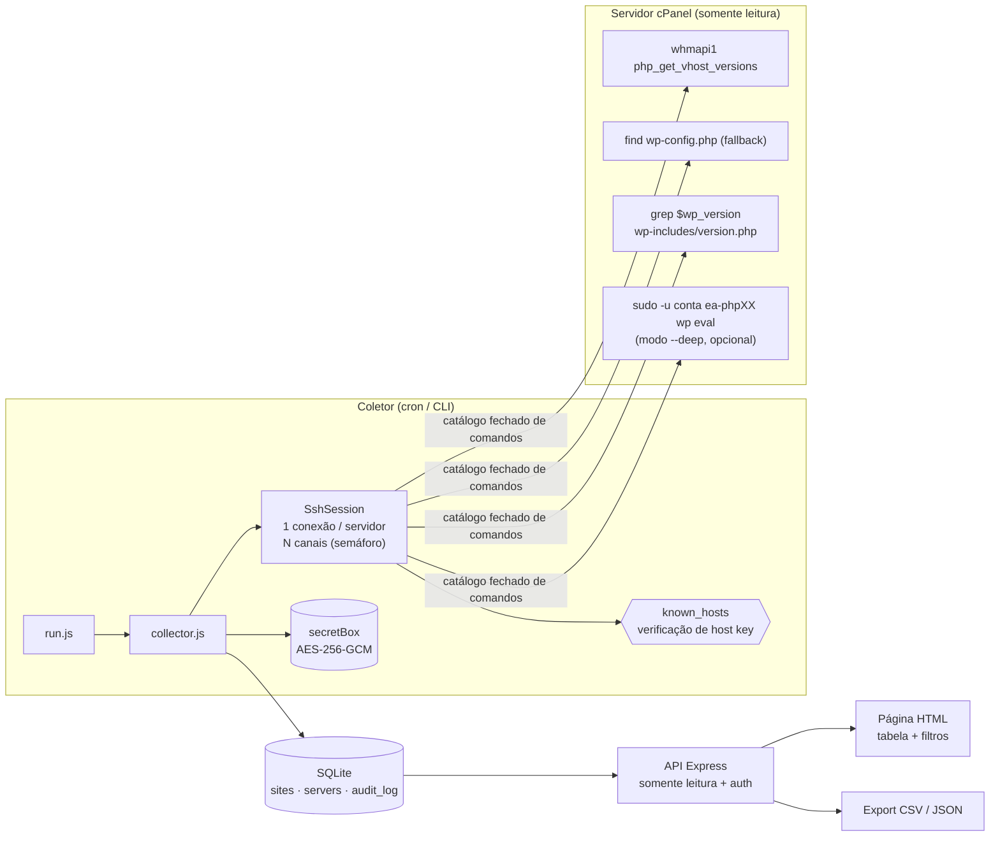

# wp-fleet-inventory

Inventário **agentless** de instalações WordPress em servidores Linux/cPanel, via SSH — sem instalar plugin, agente ou "worker" em nenhum site.

Para cada instalação, coleta: servidor, conta, domínio, docroot, versão do WordPress, versão do PHP da conta (MultiPHP), status (ok / suspensa / erro / inacessível) e grava em SQLite, com API somente leitura, página com tabela e filtros e export CSV/JSON.

> Versão de referência, escrita para portfólio, de uma ferramenta que usei em produção para uma frota de algumas centenas de sites. Nomes, dados e infraestrutura são fictícios (`example.com`, `192.0.2.0/24`).

---

## O problema

Ferramentas SaaS de gestão de WordPress funcionam com um **plugin "worker" instalado em cada site**, que conversa com a nuvem do fornecedor. Na prática isso significa:

- **Mais superfície de ataque em todos os sites**: um plugin com privilégio administrativo, endpoint exposto e cadeia de suprimentos de terceiros.
- **Dependência de conectividade externa**: quando o firewall do servidor (CSF/lfd, fail2ban, WAF) bloqueia o IP de gerenciamento do fornecedor — por exemplo, por falso positivo de regra do ModSecurity — dezenas de sites "desconectam" de uma vez e o inventário fica cego.
- **Os dados de versão já estão no servidor.** Para saber "qual WordPress e qual PHP cada site roda" não é preciso nada dentro do site.

## A abordagem

Quem já tem acesso SSH aos servidores pode perguntar diretamente ao sistema operacional e ao painel (WHM). Nada é instalado nos sites; nada fica escutando na internet.



### Fluxo por servidor

1. Abre **uma** conexão SSH, verificando a host key contra o `known_hosts`.
2. **Descoberta**: tenta a WHM API (`php_get_vhost_versions`), que já traz domínio, conta, versão de PHP e se a conta está suspensa. Se não houver WHM (ou se ela falhar/expirar), cai para `find` por `wp-config.php`, excluindo lixeiras e cópias de backup.
3. **Versão do WordPress**: lê `$wp_version` de `wp-includes/version.php` com `grep` — **sem executar PHP**.
4. **Modo `--deep` (opcional)**: faz o bootstrap via WP-CLI para obter o `siteurl` do banco, como o dono da conta e com o binário PHP correto (ver abaixo).
5. Grava o resultado (upsert por `host + docroot`) e registra na trilha de auditoria.

## Decisões de projeto

### Por que agentless
Zero código de terceiros nos sites, zero porta nova aberta, zero dependência de um serviço externo alcançar os servidores. O acesso que a equipe de infraestrutura já tem (SSH) é reaproveitado com privilégio mínimo e comandos somente leitura.

### Por que concorrência limitada (e uma conexão só)
A primeira versão abria uma conexão TCP + login SSH **por comando**. Em um servidor com 60 sites, isso dá centenas de logins em poucos segundos — exatamente a assinatura que o CSF/lfd e o fail2ban tratam como força bruta, **banindo o IP do próprio coletor**.

Aqui:
- **1 conexão por servidor**, com os comandos rodando como **canais multiplexados** sobre ela;
- um **semáforo** limita os canais simultâneos (padrão 4, abaixo do `MaxSessions 10` do sshd);
- no modo `--deep`, só 2 sites por vez (cada bootstrap do WordPress custa CPU/RAM de um servidor de produção);
- servidores coletados em sequência por padrão (`COLLECT_SERVER_CONCURRENCY=1`);
- **timeout** por comando e por servidor (um canal travado não segura a coleta inteira);
- **retry com backoff exponencial + jitter** só para erros de rede — **falha de autenticação e host key divergente nunca são repetidas** (repetir login errado é o que gera ban; repetir um MITM não faz sentido).

### A lição do MultiPHP (`ea-phpXX`)
Em servidores cPanel cada conta pode rodar uma versão de PHP diferente (MultiPHP / EasyApache). O WP-CLI é um `phar` com shebang `#!/usr/bin/env php`, então ele roda sob o **PHP padrão do sistema** — normalmente o mais novo. Sites presos a PHP 7.4 quebram com erro fatal (`get_magic_quotes_gpc()` e afins foram removidos no PHP 8).

Variáveis como `WP_CLI_PHP` **não** trocam o interpretador do phar. O que funciona é invocar o binário certo explicitamente:

```sh
sudo -n -u 'conta01' -- '/opt/cpanel/ea-php74/root/usr/bin/php' '/usr/local/bin/wp' \
  --path='/home/conta01/public_html' --skip-plugins --skip-themes eval '...'
```

O coletor monta o mapa `versão → binário` (`/opt/cpanel/ea-php*/root/usr/bin/php`) uma vez por servidor e escolhe o binário pela versão que a WHM informa para a conta.

### Por que ler `version.php` por padrão
Executar o WordPress de um cliente significa executar código PHP de terceiros — plugins e temas que podem estar comprometidos. Para saber a versão, basta ler um arquivo. O bootstrap completo fica restrito ao modo `--deep`, e mesmo nele: **como o dono da conta** (nunca root) e com `--skip-plugins --skip-themes`.

## Segurança

| Controle | Implementação |
|---|---|
| Credenciais em repouso | Senha/chave SSH cifrada com **AES-256-GCM** (`src/crypto/secretBox.js`). Chave de 32 bytes vem de `SECRETS_KEY` (ambiente), nunca do banco. IV aleatório por cifragem, envelope versionado (`v1.`), e **AAD = `server:<label>`**: copiar o segredo de uma linha para outra no banco faz a decifragem falhar. O JSON de importação nunca contém o segredo (ele vem de variável de ambiente ou de arquivo de chave). |
| Host key verification | `src/ssh/knownHosts.js` valida a chave apresentada contra um arquivo `known_hosts` (texto, hasheado `\|1\|`, `[host]:porta`, curingas, `@revoked`). Não existe modo "aceitar qualquer chave": sem `known_hosts`, a coleta não começa. |
| Comandos somente leitura | `src/ssh/commands.js` é um **catálogo fechado**. `SshSession.run()` recusa qualquer coisa que não tenha sido criada ali (verificação por `WeakSet` privado). Revisar esse arquivo é revisar tudo o que o coletor pode fazer na frota. |
| Injeção de comando | Todo valor variável (docroot, conta, caminho de binário) vem do servidor remoto e passa por `shq()` — quoting POSIX com aspas simples, testado com round-trip real em `sh`. Caminhos são validados (absolutos, sem `..`) e contas validadas por regex antes do `sudo -u`. |
| Saída remota não confiável | Parsers só aceitam formatos esperados (regex/JSON), limite de 8 MB de saída por comando, versões validadas antes de gravar. No front, tudo é inserido com `textContent`. |
| Privilégio mínimo | WP-CLI roda como o dono da conta (`sudo -n -u`), nunca com `--allow-root`. Recomendado: usuário SSH dedicado (`inventory`) com `sudoers` restrito aos comandos do catálogo. |
| Autenticação da API | Bearer token (≥ 32 caracteres) e/ou Basic com hash **bcrypt** (custo 12). Comparação em tempo constante, bloqueio por IP após 5 falhas em 10 min, `WWW-Authenticate` só quando Basic está ativo. |
| Superfície da API | Somente leitura: não há rota que dispare coleta, edite ou apague dados. Escuta em `127.0.0.1` por padrão; publique atrás de proxy reverso com TLS. |
| Cabeçalhos | CSP restritiva (`script-src 'self'`, sem inline), `frame-ancestors 'none'`, `nosniff`, `no-referrer`, `no-store`; `x-powered-by` desligado. |
| Export | CSV RFC 4180 com neutralização de **CSV/Formula Injection** (OWASP). |
| Auditoria | `audit_log` registra consultas, exports, falhas de autenticação, importação de servidores e cada coleta (início, fim, erro por servidor). Nunca grava segredos. |
| Supply chain | 4 dependências diretas, versões fixas; SQLite via módulo nativo `node:sqlite` (sem addon nativo de terceiros para compilar). |

## Como rodar o demo (sem SSH)

Requer **Node.js ≥ 22.13** (por causa do `node:sqlite`).

```bash
npm install
npm run demo
```

O demo carrega ~20 instalações fictícias **em memória** (nada é gravado em disco, nenhuma conexão SSH é feita) e imprime um token temporário no console. Abra `http://127.0.0.1:8080`, cole o token e use os filtros.

Pela API:

```bash
TOKEN=...   # o token impresso no console
curl -H "Authorization: Bearer $TOKEN" "http://127.0.0.1:8080/api/sites?status=error"
curl -H "Authorization: Bearer $TOKEN" "http://127.0.0.1:8080/api/sites/export?format=csv" -o inventario.csv
curl -H "Authorization: Bearer $TOKEN" "http://127.0.0.1:8080/api/audit?limit=20"
```

| Rota | Descrição |
|---|---|
| `GET /api/health` | Liveness (sem autenticação) |
| `GET /api/sites?q=&status=&server=` | Inventário filtrado |
| `GET /api/sites/export?format=csv\|json` | Export (respeita os filtros) |
| `GET /api/servers` | Servidores cadastrados (sem segredos) |
| `GET /api/audit?limit=` | Trilha de auditoria |

## Uso real

```bash
cp .env.example .env
npm run gen-key                       # -> SECRETS_KEY
npm run gen-key                       # -> API_TOKEN
echo -n 'senha-longa' | npm run hash-password   # -> BASIC_AUTH_HASH (opcional)

# known_hosts: colete e CONFIRME o fingerprint por um canal confiável
ssh-keyscan -p 22 srv-01.example.com >> data/known_hosts
ssh-keygen -lf data/known_hosts

cp examples/servers.example.json data/servers.json   # ajuste hosts e caminhos de chave
npm run import-servers -- data/servers.json          # cifra e grava os segredos

npm run collect                         # todos os servidores, modo seguro
npm run collect -- --server srv-01 --deep
npm run export -- --format csv --out data/inventario.csv
npm start
```

## Testes

```bash
npm test        # node:test — quoting de shell, parsers, cifra, known_hosts, concorrência, coletor com sessão falsa
npm run check   # node --check em todos os arquivos
```

## Limitações

- Focado em cPanel/WHM. Em servidores sem WHM a descoberta usa `find` e não há versão de PHP por site nem detecção de conta suspensa.
- O modo padrão não lê o banco: o domínio vem da WHM; sem ela, só com `--deep`.
- Não verifica disponibilidade HTTP, certificados TLS, plugins/temas ou vulnerabilidades conhecidas — o inventário é a base para essas checagens, não as substitui.
- `known_hosts`: `@cert-authority` (certificados SSH) não é suportado.
- A cifra protege contra vazamento do banco, **não** contra quem tem acesso ao ambiente do processo (onde está `SECRETS_KEY`). Para isso, use um cofre externo (Vault, KMS) — o ponto de troca é `buildTarget()` em `src/collector/collector.js`.
- Bloqueio por IP da API é em memória (reinicia com o processo) e pensado para instância única.
- `node:sqlite` ainda é marcado como experimental no Node 22 e emite um aviso na inicialização.

## Licença

[MIT](LICENSE) © 2026 Lygia Teixeira
